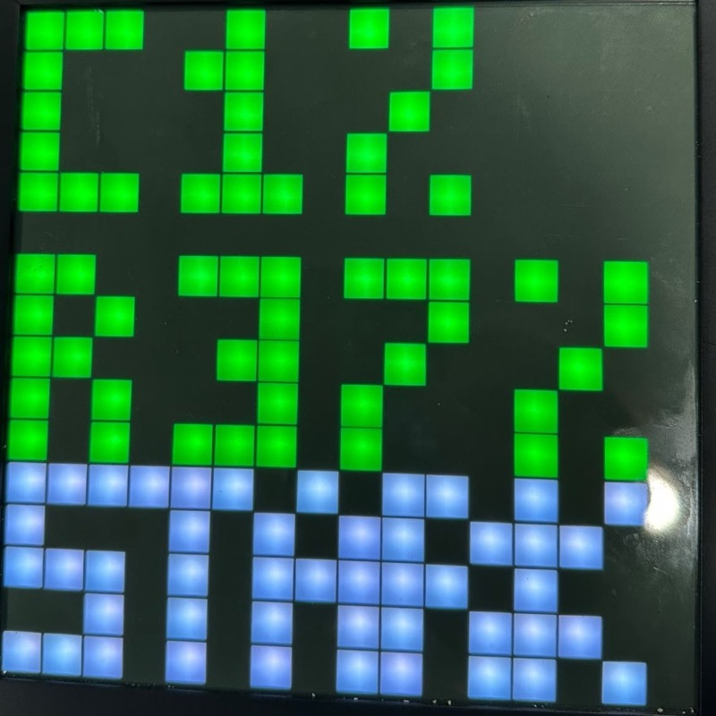
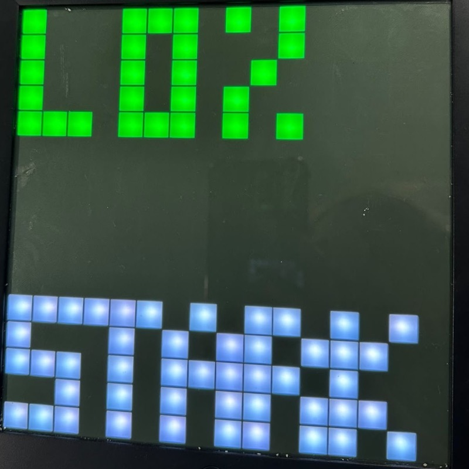
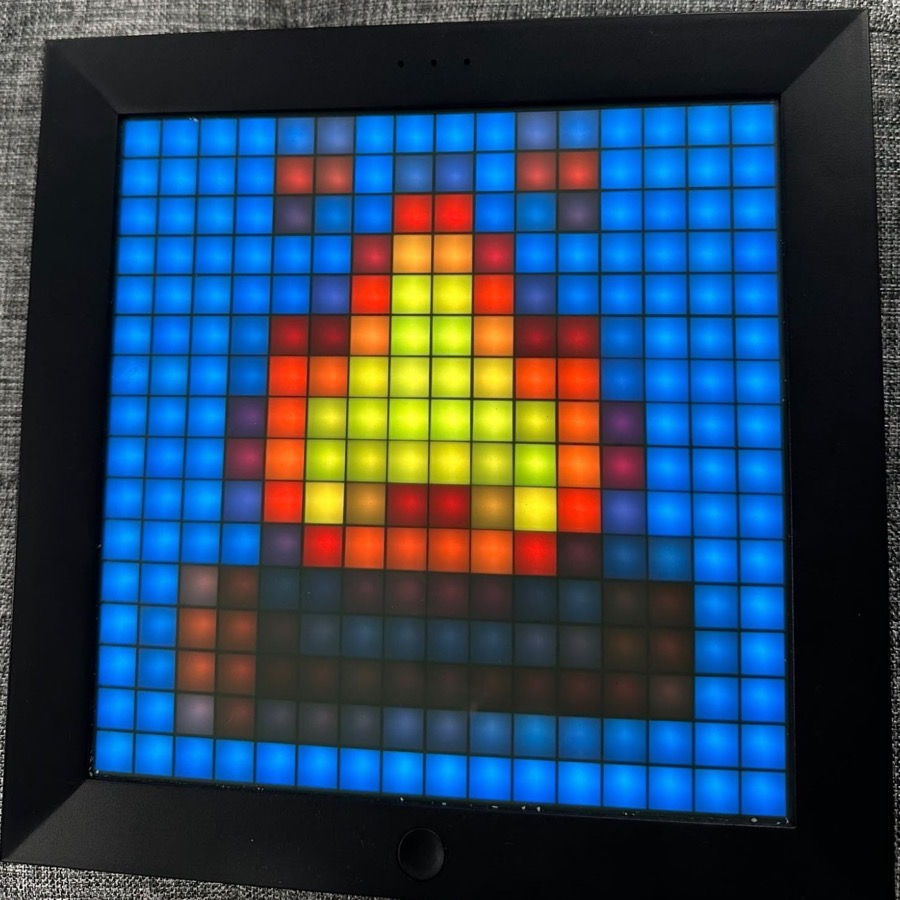

<p align="center">
  
</p>

# pxls

Open-source dashboard for custom messaging and integrations on legacy Divoom Pixoo Bluetooth devices (16x16).

> pxls is an unofficial community project. It is not affiliated with, endorsed by, or sponsored by Divoom. "Pixoo" and "Divoom" are trademarks of their respective owners and are used here only to describe compatible hardware.

## What it does

pxls runs next to your Pixoo, talks to it over Bluetooth, and gives you a web UI to decide what it shows.

- **Page rotation.** Build a list of pages and cycle through them on a timer. Page types:
  - Clock and weather
  - System stats, GPU stats and temperatures (from dashdot or Beszel)
  - Custom text
  - Pixel art, drawn pixel by pixel
  - Uploaded images and animations
  - Custom scripts
- **Native Divoom modes.** Let the device render its own environment clock, light, music, user or score modes.
- **Webhooks.** Receive events from other services (for example Radarr or Sonarr). Rules match on the payload and trigger a notification, an image, a screen flash and more. Every received event is logged and can be replayed.
- **Tools.** Countdown, sound detector and scoreboard.
- **Device control.** Connect and disconnect, live brightness, native mode settings.
- **Diagnostics.** For admins, behind a flag: send raw commands, sweep values and run quick device tests.

## On the device

Photos from a real Pixoo running pxls: Beszel system stats, an animated GIF, and the clock and calendar page. These are a sample, not every page type. More in the [gallery](docs/gallery.md).

<p>
  
  
  
  
</p>

## Requirements

- A legacy Pixoo with Bluetooth (16x16) within range of the host
- A Linux host with Bluetooth. The container needs host networking (Bluetooth sockets only work in the host network namespace) and access to `/dev`
- Docker with Compose

Bluetooth access from inside a container is the fiddly part. pxls runs `privileged` with the host's `/dev` mounted, and binds the display to `/dev/rfcommN` with BlueZ's `rfcomm` tool (included in the image). Narrowing this is on the roadmap.

The images are built for `linux/amd64` and `linux/arm64`, so a Raspberry Pi works.

## Quick start

```bash
git clone https://github.com/elekib/pxls.git
cd pxls
cp .env.example .env
# Edit .env: set TZ (and optionally PIXOO_MAC)
make dev
```

`make dev` builds the image from source and starts it (`docker compose -f compose.yaml -f compose.build.yaml up --build -d`). Published images are not available yet; once they are, `docker compose up -d` runs the published image instead.

Open http://localhost:3030. On first run pxls asks you to create the admin account (see [Authentication](#authentication)). Then open the **Device** page, enter your Pixoo's Bluetooth MAC address (format `AA:BB:CC:DD:EE:FF`; `bluetoothctl devices` lists the devices your host knows, after you pair the display with it) and connect.

## Updating

```bash
git pull
make dev
```

Your data in `./data` is kept and the database is upgraded on start. Back it up first (see [Configuration](#configuration)).

## Authentication

pxls has user accounts. There are no default credentials and no shared token. Everything except `/api/health` and the webhook receiver requires a signed-in user.

### First run: create the admin

With no accounts, pxls prints a one-time setup code to its log, and the web UI shows a setup form instead of a login form:

```bash
docker logs pxls 2>&1 | grep -i "setup code"
```

Open http://localhost:3030, enter that code, and choose an admin username and password. This proves you control the server, so a stranger who finds a fresh instance on your network cannot claim it. The code works until an admin exists, is checked in constant time, is rate limited, and is regenerated (and the old one invalidated) on every restart while no accounts exist.

### Users and roles

| Role | Can do |
|---|---|
| `admin` | Everything, plus the **Users** page: create, disable and delete users, change roles, reset passwords, revoke sessions |
| `viewer` | Read-only: device status, pages and event logs. Cannot change anything, see webhook definitions (they contain secrets) or manage users |

There is no self-registration; an admin creates accounts. Passwords are 12 to 128 characters and are stored as argon2id hashes with a per-user salt. The last enabled admin cannot be deleted, disabled or demoted.

### Sessions

Accounts and sessions are handled by [Better Auth](https://www.better-auth.com), on the same `pxls.db`.

- The web UI signs you in with an `httpOnly`, `SameSite=Strict` session cookie, and pages are rendered on the server for the signed-in user. When the session ends, you are sent to the sign-in page.
- Scripts sign in through `/api/auth/sign-in/username` and send the returned session token as `Authorization: Bearer` (see [Scripts and automation](#scripts-and-automation)).
- Sessions live in the database, so they can be listed and revoked on the **Account** page (and by an admin). Revoking, signing out, disabling a user or changing a password takes effect immediately. Changing a password signs that user out everywhere.
- A session expires after 7 days without use.
- The signing secret is generated on first start and stored in `pxls.db`. Set `PXLS_AUTH_SECRET` (32+ characters) to supply your own; changing it signs everyone out.
- Sign-in is rate limited per client address: 10 attempts per 15 minutes, after which that address gets `429`. Error messages never say whether an account exists.
- Rate limits and logs use the real client address. Behind a reverse proxy on your network, the client IP comes from `X-Real-IP`, which is only trusted from loopback or private peers; a client's own `X-Forwarded-For` is ignored. IPv6 addresses are limited per /64 network, and the Account page shows them masked to it.

### Scripts and automation

There is no static API token. Use a dedicated account (a `viewer` for read-only scripts). Sign in, then send the `set-auth-token` response header as a bearer token:

```bash
TOKEN=$(curl -si -H 'Content-Type: application/json' \
  -d '{"username":"script","password":"..."}' http://localhost:3030/api/auth/sign-in/username \
  | awk -F': ' 'tolower($1)=="set-auth-token"{print $2}' | tr -d '\r')
curl -s -H "Authorization: Bearer $TOKEN" http://localhost:3030/api/config
```

The token is the session itself: it lasts until you sign out (`POST /api/auth/sign-out`), an admin revokes it, or it has been unused for 7 days. Admins can also manage users with the `/api/auth/admin/*` endpoints.

Requests that use the browser cookie (not a bearer token) and change state need the `X-Requested-With: pxls` header (CSRF protection).

Set `PXLS_BASE_URL` to the public address you reach pxls at (for example `https://pxls.example.com`). Better Auth then trusts that origin, and the session cookie gets the `Secure` flag when it is `https`. Behind a reverse proxy that rewrites the `Host` header, you can instead add the public origin to `PXLS_ALLOWED_ORIGINS`.

### Lost the admin password

Stop pxls and remove all accounts and sessions so first-run setup returns. This signs everyone out, and keeps your configuration, pages and webhooks. It needs the `sqlite3` command on the host (for example `sudo apt install sqlite3` on Debian-based systems):

```bash
docker compose stop pxls
sqlite3 data/pxls.db "DELETE FROM session; DELETE FROM account; DELETE FROM user;"
docker compose start pxls && docker logs pxls 2>&1 | grep -i "setup code"
```

Then open pxls and create the admin again with the new setup code.

Incoming webhooks use their own secret instead of a user account (see [Webhooks](#webhooks)).

## Configuration

| Variable | Default | Purpose |
|---|---|---|
| `PIXOO_MAC` | empty | Bluetooth MAC of the display. Optional: the MAC saved with **Connect** on the Device page takes precedence |
| `PIXOO_CHANNEL` | `1` | RFCOMM channel of the display's serial port |
| `PIXOO_RFCOMM_DEV` | `0` | N in `/dev/rfcommN`; change it if another device uses rfcomm0 |
| `PXLS_PORT` | `3030` | Port for the web UI, API and webhook receiver |
| `PXLS_AUTH_SECRET` | generated | Optional signing secret for sessions, 32+ characters. By default one is generated on first start and stored in the database |
| `PXLS_BASE_URL` | derived | Public URL of pxls (for example `https://pxls.example.com`). Set it behind a reverse proxy; `https` makes the session cookie `Secure` |
| `PXLS_COOKIE_SECURE` | auto | Set `true` to always mark the session cookie `Secure` (use when serving over HTTPS and `PXLS_BASE_URL` is not set) |
| `TZ` | `UTC` | Container timezone (log timestamps). Clock pages use the timezone set on the Device page |
| `PXLS_ALLOWED_ORIGINS` | empty | Comma-separated extra origins trusted by the sign-in origin check, for reverse proxies that rewrite `Host`. The UI and API share one origin, so leave it empty otherwise |
| `PXLS_ALLOW_PRIVATE_URLS` | `false` | Let webhook image URLs point at private or LAN addresses (for example a Jellyfin server). Off by default to prevent server-side request forgery |
| `PXLS_ENABLE_DEBUG` | `0` | Set `1` to enable the admin Diagnostics page (raw device commands). Leave off unless you are testing hardware |
| `PXLS_LOG_PACKETS` | `0` | Set `1` to log every packet sent to the device, in hex |
| `PXLS_TOOL_CLOSE_LINK` | `0` | Set `1` to release the Bluetooth link after starting a tool, for devices that need it |
| `PXLS_WEATHER_URL` | empty | URL that returns the current weather as JSON for the clock and weather page. Without it the page shows only the clock and date. See [Weather](#weather) |
| `PXLS_TAG` | `latest` | Image tag for `docker compose`: `latest`, `dev` or a release version |

Device settings, pages and the rest of the app configuration are edited in the web UI. Everything except uploads is stored in one SQLite database, `./data/pxls.db` (with `pxls.db-wal` and `pxls.db-shm` next to it while running), created on first run. Uploaded images live in `./data/uploads`. The `data/` directory and `.env` are git-ignored so they never get committed.

**`pxls.db` holds secrets** (webhook secrets, Beszel credentials, the full config). Keep `./data` private, and back it up. Stop the container and copy `pxls.db` together with its `-wal` and `-shm` files, or take a consistent copy while running with `sqlite3 data/pxls.db ".backup 'pxls-backup.db'"`.

## Webhooks

Point a sender at `POST /api/webhook/<name>`, for example a Radarr or Sonarr "Webhook" connection:

```
http://<host>:3030/api/webhook/radarr
```

Each webhook has a secret, generated when you create it. Copy it from the webhook card on the **Webhooks** page. Senders can present it in any of these ways:

- `X-Webhook-Secret: <secret>` header
- HTTP Basic auth with the secret as the password (any username). Radarr and Sonarr support this
- `?secret=<secret>` in the URL, for senders that can do neither. The URL then acts like a password and can show up in logs

A webhook with a missing or wrong secret, or an unknown name, gets `401`.

Define rules on the **Webhooks** page. Use the **Event Logs** page to inspect incoming payloads, test rules and replay events.

## Project layout

| Path | Contents |
|---|---|
| `web/` | The pxls app: Next.js UI and API, the display engine and render loop (`src/lib/engine`, `src/lib/render`), and the Bluetooth driver (`src/lib/device`, `src/lib/protocol`) |
| `docs/` | Protocol reference, architecture and versioning |
| `scripts/` | Optional helper scripts |
| `compose.yaml` | Run the published image |
| `compose.build.yaml` | Overlay that builds the image from source |

## Status and security

Early development. The API requires a signed-in user, but the Bluetooth device is controlled by the host, so keep pxls on a trusted network and put TLS in front of it before exposing port 3030 beyond your LAN. See [SECURITY.md](SECURITY.md).

## Weather

pxls does not ship a weather service. Point `PXLS_WEATHER_URL` at any URL that answers a `GET` with the two values the clock and weather page draws:

```json
{ "temp": 21.6, "code": 3 }
```

- `temp`: the temperature as a number, in the unit pxls asks for. Required.
- `code`: a WMO weather interpretation code for the icon (0 clear, 1-3 cloudy, 45/48 fog, 51-65 rain, 71-77 snow, 95-99 storm). Optional; without it there is no icon.

`{location}` and `{unit}` in the URL are replaced with the page's location and `celsius` or `fahrenheit` (for example `http://bridge.lan/weather?q={location}&u={unit}`). pxls fetches only when the URL is set, caches the answer for 10 minutes, and draws the temperature row only when it gets a valid reply: on any error, nothing is drawn in its place. The URL is never logged, so it may carry a token. Most weather APIs return a different shape, so run a small bridge that converts one to this format; you are responsible for that service's terms.

## Documentation

- [Bluetooth protocol](docs/protocol.md) (pxls's own driver; per-command verification status and a device test checklist)
- [On the device](docs/gallery.md) (photos of pages on a real Pixoo)
- [How the app fits together](docs/architecture.md) and [versioning and releases](docs/versioning.md)
- [Contributing](CONTRIBUTING.md) and [architecture notes](AGENTS.md)
- [Changelog](CHANGELOG.md)

## Contributing

Issues and pull requests are welcome. Read [CONTRIBUTING.md](CONTRIBUTING.md) first. Commits must be signed off (`git commit -s`) to certify the Developer Certificate of Origin.

## License

pxls is licensed under the [Apache License 2.0](LICENSE). See [NOTICE](NOTICE) for the copyright and trademark notices.
