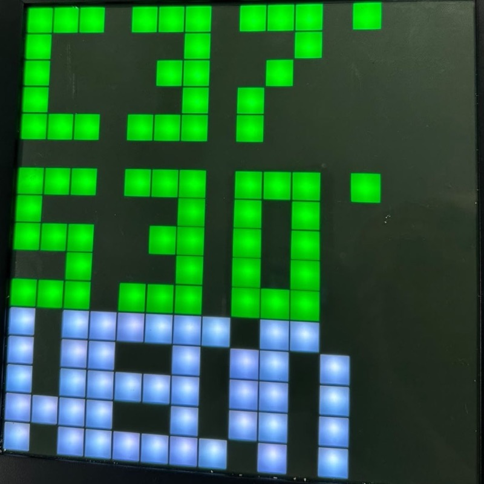

# On the device

Photos taken on a real 16x16 Pixoo running pxls. They show a few of the page types, not all of them.

## Beszel system stats

The system stats page pulls live metrics from [Beszel](https://github.com/henrygd/beszel) and draws them with pxls's own bitmap font. Each metric gets its own row, and the colour follows the value.

  
  
  

## Animations

Uploaded GIFs and animations are scaled to 16x16 and played on the device. This one is a campfire.

  

## Clock and calendar

The clock and weather page shows the time, the date and the current conditions on one screen.

  

See the [README](../README.md#what-it-does) for the full list of page types.
